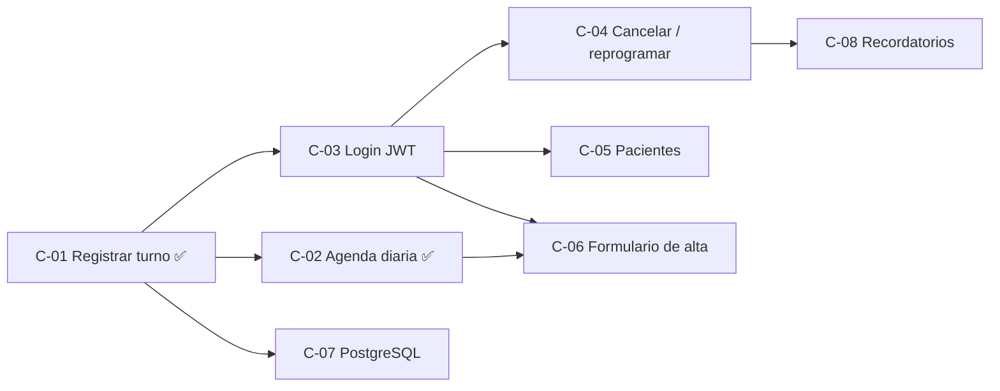

# Roadmap de changes

Plan de evolución del sistema en changes OpenSpec. Cada change pasa por **explore → propose → apply → verify → archive**. El estado real lo tiene `openspec list` y la carpeta `openspec/changes/archive/`.

**Entrega TPI:** C-01 y C-02 (archivados). El resto es trabajo futuro y no forma parte de la entrega.

## Resumen

| ID | Change OpenSpec | Fase | Necesidad | Riesgo | Depende de | Estado |
| --- | --- | --- | --- | --- | --- | --- |
| C-01 | `registrar-turno-sin-solapamientos` | 1 · Núcleo de agenda | D-01 | Alto | — | ✅ Archivado 2026-11-16 |
| C-02 | `consultar-agenda-diaria` | 1 · Núcleo de agenda | D-02 | Medio | C-01 | ✅ Archivado 2026-11-16 |
| C-03 | `autenticar-personal-jwt` | 2 · Seguridad | D-03 | Alto | C-01 | Pendiente |
| C-04 | `cancelar-y-reprogramar-turnos` | 3 · Ciclo del turno | D-04 | Alto | C-01, C-03 | Pendiente |
| C-05 | `administrar-pacientes` | 3 · Ciclo del turno | D-04 | Medio | C-03 | Pendiente |
| C-06 | `formulario-alta-recepcion` | 4 · Interfaz | D-01, D-02 | Bajo | C-02, C-03 | Pendiente |
| C-07 | `persistencia-postgresql` | 5 · Operación | D-01 | Alto | C-01 | Pendiente |
| C-08 | `recordatorios-de-turnos` | 5 · Operación | D-05 | Medio | C-04 | Pendiente |

## Detalle

### Fase 1 — Núcleo de agenda (entrega)

**C-01 `registrar-turno-sin-solapamientos`** — API `POST /turnos` con FastAPI y SQLAlchemy. Rechaza choques de profesional y de box sobre `[inicio, fin)`, valida fechas con zona horaria y serializa altas simultáneas. *Leer antes:* KB 04 y 06. *Archivo:* `openspec/changes/archive/2026-11-16-registrar-turno-sin-solapamientos/`.

**C-02 `consultar-agenda-diaria`** — `GET /agenda` por día local con filtros y pantalla React "Agenda del día". *Leer antes:* KB 05 y 06. *Archivo:* `openspec/changes/archive/2026-11-16-consultar-agenda-diaria/`.

### Fase 2 — Seguridad

**C-03 `autenticar-personal-jwt`** — Login del personal con JWT (PyJWT) y roles Recepción / Profesional / Administración. *Decisión a aprobar en Propose:* matriz de permisos y duración del token.

### Fase 3 — Ciclo del turno

**C-04 `cancelar-y-reprogramar-turnos`** — Estados del turno (reservado, cancelado, atendido). Un turno cancelado libera el horario sin borrarse. *Decisión a aprobar:* si un turno cancelado puede reactivarse.

**C-05 `administrar-pacientes`** — Alta y edición de pacientes ficticios con validación de datos.

### Fase 4 — Interfaz

**C-06 `formulario-alta-recepcion`** — Formulario React que usa `POST /turnos` y muestra los errores 404/409/422 de forma clara.

### Fase 5 — Operación

**C-07 `persistencia-postgresql`** — PostgreSQL opcional mediante `ODONTOLOGIA_DB_URL`, con bloqueo equivalente a `BEGIN IMMEDIATE` y pruebas aisladas.

**C-08 `recordatorios-de-turnos`** — Recordatorios en una tabla *outbox* con un envío **simulado** (sin WhatsApp ni proveedores reales).

## Reglas del roadmap

- No se empieza un change sin archivar el anterior del que depende.
- Las decisiones de riesgo **Alto** se aprueban en Propose antes de implementar.
- Cada change trae sus pruebas; no se archiva con pruebas fallando.
