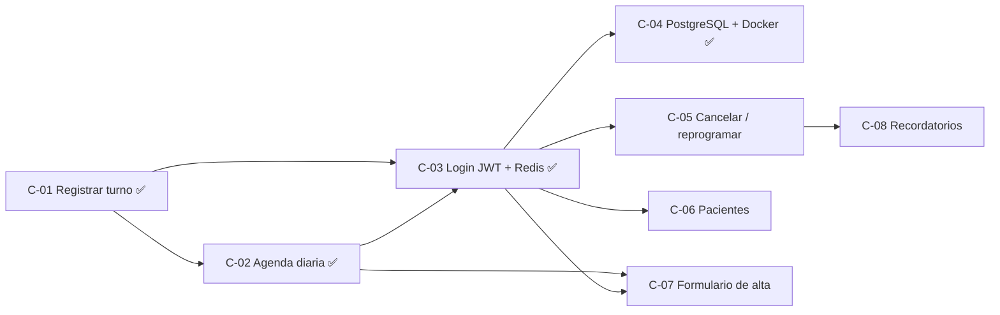

# Roadmap de changes

Plan de evolución del sistema en changes OpenSpec. Cada change pasa por **explore → propose → apply → verify → archive**. El estado real lo muestran `openspec list` y la carpeta `openspec/changes/archive/`.

**Entrega TPI:** C-01 a C-04, archivados. Con ellos el sistema usa el **stack completo indicado por la cátedra**: Python, FastAPI, JWT, SQLAlchemy, PostgreSQL, Redis, Docker / Docker Compose, React, TypeScript y Vite. C-05 a C-08 son trabajo futuro.

## Resumen

| ID | Change OpenSpec | Fase | Necesidad | Stack que incorpora | Riesgo | Depende de | Estado |
| --- | --- | --- | --- | --- | --- | --- | --- |
| C-01 | `registrar-turno-sin-solapamientos` | 1 · Núcleo de agenda | D-01 | Python, FastAPI, SQLAlchemy | Alto | — | ✅ Archivado |
| C-02 | `consultar-agenda-diaria` | 1 · Núcleo de agenda | D-02 | React, TypeScript, Vite | Medio | C-01 | ✅ Archivado |
| C-03 | `autenticar-personal-jwt` | 2 · Seguridad | D-03 | JWT, Redis | Alto | C-01, C-02 | ✅ Archivado |
| C-04 | `persistencia-postgresql-y-docker` | 2 · Operación | D-01 | PostgreSQL, Docker Compose | Alto | C-01, C-03 | ✅ Archivado |
| C-05 | `cancelar-y-reprogramar-turnos` | 3 · Ciclo del turno | D-04 | — | Alto | C-03 | Pendiente |
| C-06 | `administrar-pacientes` | 3 · Ciclo del turno | D-04 | — | Medio | C-03 | Pendiente |
| C-07 | `formulario-alta-recepcion` | 4 · Interfaz | D-01, D-02 | — | Bajo | C-02, C-03 | Pendiente |
| C-08 | `recordatorios-de-turnos` | 5 · Comunicación | D-05 | Redis como cola | Medio | C-05 | Pendiente |

## Detalle

### Fase 1 — Núcleo de agenda

**C-01 `registrar-turno-sin-solapamientos`** — `POST /turnos` con FastAPI y SQLAlchemy. Rechaza choques de profesional y de box sobre `[inicio, fin)`, valida fechas con zona horaria y serializa altas simultáneas (`BEGIN IMMEDIATE`). *Leer antes:* KB 04 y 06.

**C-02 `consultar-agenda-diaria`** — `GET /agenda` por día local con filtros y pantalla React "Agenda del día". *Leer antes:* KB 05 y 06.

### Fase 2 — Seguridad y operación

**C-03 `autenticar-personal-jwt`** — Login con JWT, roles Recepción / Profesional / Administración, permisos en el backend y cierre de sesión con Redis. Pantalla de ingreso. *Decisión aprobada:* matriz de permisos (KB 02).

**C-04 `persistencia-postgresql-y-docker`** — PostgreSQL con bloqueo `FOR UPDATE` para mantener la garantía de no solapamiento, y Docker Compose con PostgreSQL, Redis, backend y frontend.

### Fase 3 — Ciclo del turno (futuro)

**C-05 `cancelar-y-reprogramar-turnos`** — Estados del turno (reservado, cancelado, atendido). Un turno cancelado libera el horario sin borrarse. *Decisión a aprobar:* si un turno cancelado puede reactivarse (Q05).

**C-06 `administrar-pacientes`** — Alta y edición de pacientes ficticios con validación.

### Fase 4 — Interfaz (futuro)

**C-07 `formulario-alta-recepcion`** — Formulario React que usa `POST /turnos` y muestra los errores 404/409/422 de forma clara.

### Fase 5 — Comunicación (futuro)

**C-08 `recordatorios-de-turnos`** — Recordatorios encolados en Redis y enviados por un canal **simulado** (sin WhatsApp ni proveedores reales). *Decisión a aprobar:* anticipación del recordatorio (Q06).

## Reglas del roadmap

- No se empieza un change sin archivar los anteriores de los que depende.
- Las decisiones de riesgo **Alto** se aprueban en Propose antes de implementar.
- Cada change trae sus pruebas; no se archiva con pruebas fallando.
- El stack de la cátedra no se reemplaza ni se omite sin una decisión registrada en KB 07.
