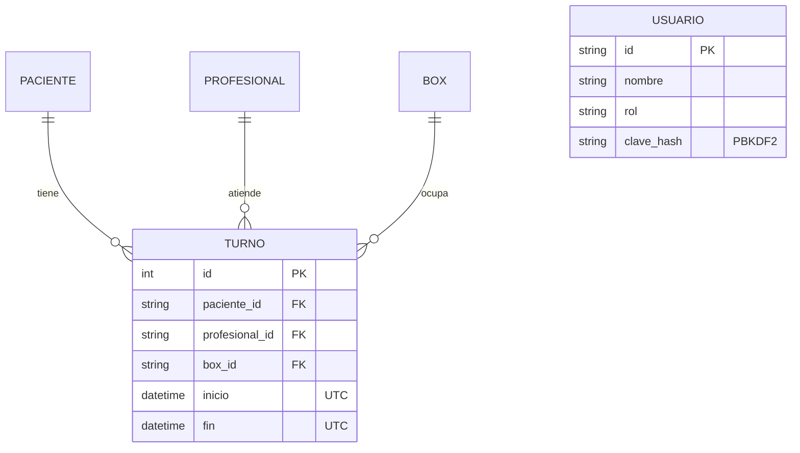

# 03 — Modelo de datos



| Entidad | Campos | Notas |
| --- | --- | --- |
| Paciente | `id` (hasta 64), `nombre` | Ficticio |
| Profesional | `id`, `nombre` | Ficticio. Su fila se bloquea al registrar un turno en PostgreSQL |
| Box | `id`, `nombre` | Sillón / consultorio físico. Ídem |
| Turno | `id`, `paciente_id`, `profesional_id`, `box_id`, `inicio`, `fin` | `[inicio, fin)` en UTC |
| Usuario | `id`, `nombre`, `rol`, `clave_hash` | Personal (C-03). Nunca se guarda la clave en texto |

Fuera de la base: las **sesiones cerradas** se guardan en Redis como `odontologia:revocado:<jti>` con vencimiento automático.

## Catálogo ficticio (`backend/odontologia/datos_demo.py`)

| Tipo | IDs |
| --- | --- |
| Pacientes | `PAC-001` Paciente Ficticio Uno, `PAC-002` Paciente Ficticio Dos |
| Profesionales | `PRO-001` Odontóloga Ficticia A, `PRO-002` Odontólogo Ficticio B |
| Boxes | `BOX-1`, `BOX-2` |
| Usuarios | `recepcion`, `profesional`, `admin` |

## Ejemplo de turno

```json
{
  "paciente_id": "PAC-001",
  "profesional_id": "PRO-001",
  "box_id": "BOX-1",
  "inicio": "2026-12-01T09:00:00-03:00",
  "fin": "2026-12-01T09:30:00-03:00"
}
```
