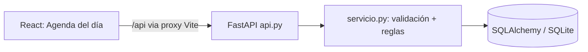

# 06 — Arquitectura

## Stack (definido por la cátedra)

| Parte | Tecnología | Carpeta |
| --- | --- | --- |
| API | Python 3.12+, FastAPI, Uvicorn | `backend/odontologia/api.py` |
| Reglas de negocio | Python puro | `backend/odontologia/servicio.py` |
| Persistencia | SQLAlchemy 2 + SQLite (PostgreSQL en C-07) | `backend/odontologia/db.py` |
| Autenticación | JWT con PyJWT | C-03 (pendiente) |
| Frontend | React 19 + TypeScript + Vite 6 | `frontend/` |
| Pruebas | `unittest` + `TestClient`; `node:test` + `tsx` | `backend/tests/`, `frontend/src/*.test.ts` |
| Especificación | OpenSpec | `openspec/` |

Redis y Docker figuran en la consigna general de la cátedra pero no son necesarios para este alcance; no se agregan como dependencia.

## Capas

- **api.py** traduce HTTP ↔ servicio y convierte `ErrorTurno` en `{error, campo, mensaje}`.
- **servicio.py** valida y aplica RN-01..RN-04. Es lo único que conoce las reglas.
- **db.py** define modelos, el catálogo ficticio y el `BEGIN IMMEDIATE`.
- **frontend** sólo consume la API y da formato.

## Endpoints

| Método | Ruta | Change | Respuestas |
| --- | --- | --- | --- |
| GET | `/health` | C-01 | 200 |
| POST | `/turnos` | C-01 | 201, 404, 409, 422 |
| GET | `/agenda?fecha=&profesional_id=&box_id=` | C-02 | 200, 404, 422 |
| GET | `/catalogo` | C-02 | 200 |
| GET | `/docs` | — | Swagger generado por FastAPI |

## Concurrencia
La consulta de choques y el INSERT van en una transacción que empieza con `BEGIN IMMEDIATE` en SQLite: la segunda alta espera (hasta 5 s) y luego ve la primera. Ver C-01 `design.md` D5.
