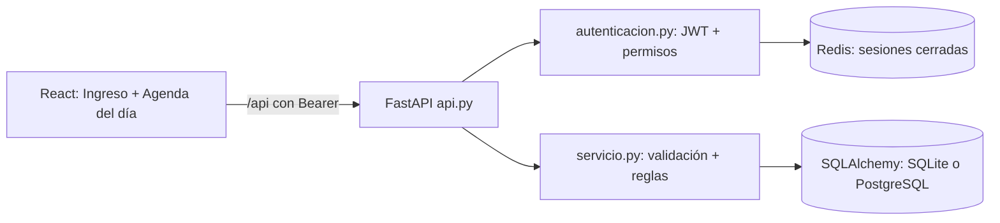

# 06 — Arquitectura

## Stack (definido por la cátedra) y dónde se usa

| Tecnología | Para qué | Dónde | Change |
| --- | --- | --- | --- |
| Python 3.12+ / FastAPI / Uvicorn | API | `backend/odontologia/api.py` | C-01 |
| SQLAlchemy 2 | Persistencia | `backend/odontologia/db.py` | C-01 |
| SQLite | Base por defecto para desarrollo | archivo `odontologia.db` | C-01 |
| React + TypeScript + Vite | Pantallas | `frontend/` | C-02 |
| JWT (PyJWT) | Sesión del personal | `backend/odontologia/autenticacion.py` | C-03 |
| Redis | Sesiones cerradas (revocación de JWT) | `RevocacionesRedis` | C-03 |
| PostgreSQL 16 (psycopg 3) | Base de producción | `ODONTOLOGIA_DB_URL` | C-04 |
| Docker / Docker Compose | Levantar todo junto | `docker-compose.yml`, `*/Dockerfile` | C-04 |
| unittest + TestClient · node:test + tsx | Pruebas | `backend/tests/`, `frontend/src/*.test.ts` | Todos |
| OpenSpec | Especificación | `openspec/` | Todos |

## Capas

- **api.py** traduce HTTP ↔ servicio, aplica la sesión y el permiso como dependencias y convierte `ErrorTurno` en `{error, campo, mensaje}`.
- **autenticacion.py** hashea claves, emite y valida JWT, guarda revocaciones y define `PERMISOS`.
- **servicio.py** valida y aplica las reglas de la agenda.
- **db.py** define modelos, catálogo ficticio y la configuración de cada base.
- **frontend** sólo consume la API, guarda el token y da formato.

## Endpoints

| Método | Ruta | Sesión | Change | Respuestas |
| --- | --- | --- | --- | --- |
| GET | `/health` | Pública | C-01 | 200 |
| POST | `/auth/login` | Pública | C-03 | 200, 401, 422 |
| POST | `/auth/logout` | Cualquier rol | C-03 | 204, 401 |
| GET | `/auth/yo` | Cualquier rol | C-03 | 200, 401 |
| POST | `/turnos` | recepcion, administracion | C-01 | 201, 401, 403, 404, 409, 422 |
| GET | `/agenda?fecha=&profesional_id=&box_id=` | Cualquier rol | C-02 | 200, 401, 404, 422 |
| GET | `/catalogo` | Cualquier rol | C-02 | 200, 401 |
| GET | `/docs` | — | — | Swagger (botón **Authorize**) |

## Configuración

| Variable | Uso | Por defecto |
| --- | --- | --- |
| `ODONTOLOGIA_DB_URL` | Base de datos | `sqlite:///./odontologia.db` |
| `ODONTOLOGIA_JWT_SECRETO` | Firma de JWT (≥ 32 caracteres) | Temporal al azar, con advertencia |
| `ODONTOLOGIA_REDIS_URL` | Redis para sesiones cerradas | En memoria |

## Concurrencia
La consulta de choques y el INSERT van en la misma transacción. SQLite: `BEGIN IMMEDIATE` (C-01). PostgreSQL: `SELECT … FOR UPDATE` de la fila del profesional y luego del box (C-04).

## Docker Compose (C-04)

| Servicio | Imagen | Puerto local |
| --- | --- | --- |
| `db` | `postgres:16-alpine` | — (interno) |
| `redis` | `redis:7-alpine` | — (interno) |
| `backend` | `backend/Dockerfile` | `127.0.0.1:8000` |
| `frontend` | `frontend/Dockerfile` (Nginx) | `127.0.0.1:8080` |
